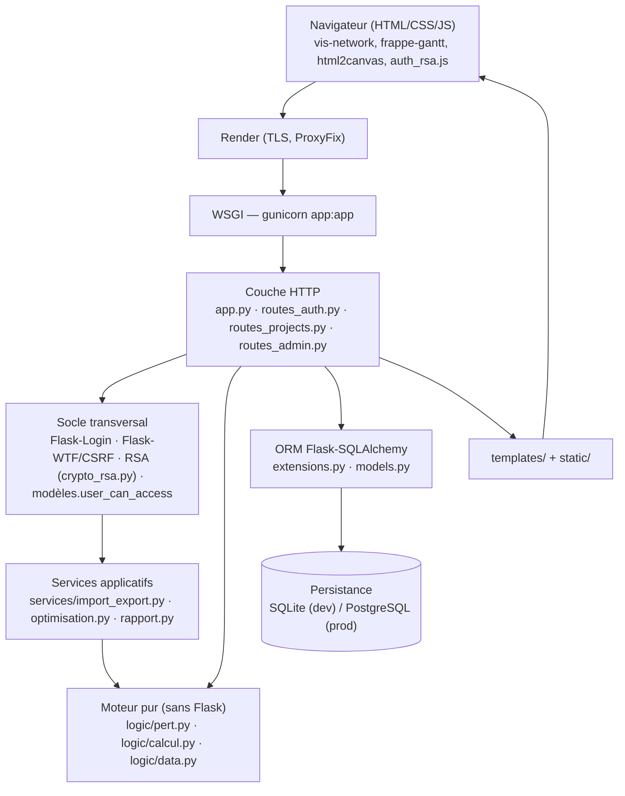
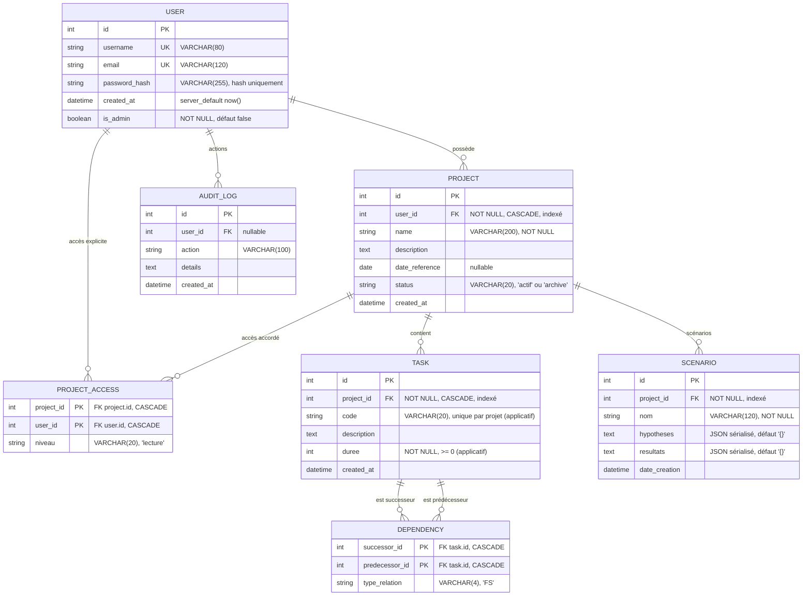

# Documentation technique — PERT/CPM PRO

**Date :** 21 novembre 2026  
**Version du document :** 1.0  
**Références :** `docs/Cahier_des_charges_PERT_CPM_PRO.docx` (v1.0), `docs/convention_calcul.md`, `docs/audit.md`, `docs/plan_implementation.md`.  
**État du livrable :** lots 0 à 6 livrés (moteur certifié, socle sécurisé, persistance, espace projets/tâches, visualisations, optimisation, exports serveur) et lot IA-1 livré (assistant conversationnel, §19). Le blueprint d'administration (`routes_admin.py`) reste en cours de finalisation par un autre agent.  
**Application déployée :** <https://app-pert-cpm.onrender.com/> — supervision : `GET /health`.

> Ce document décrit le code tel qu'il existe dans le dépôt. Toute divergence constatée avec l'application déployée doit être consignée dans `docs/audit.md` avant d'être corrigée.

## 1. Architecture

### 1.1 Schéma des couches



Lecture du schéma :

1. **Entrée** : requête HTTPS terminée par Render, transmise à gunicorn ; `ProxyFix` rétablit le schéma, l'hôte et l'adresse IP d'origine (`app.py`).
2. **Routage et sécurité** : les blueprints appliquent `login_required`, le contrôle d'accès serveur et les jetons CSRF ; `ajouter_en_tetes_securite()` complète la réponse.
3. **Métier** : les routes ne stockent que des données sources (tâches, durées, prédécesseurs) ; elles appellent toujours le moteur pour obtenir les résultats chiffrés.
4. **Sortie** : rendu Jinja2 ou téléchargement (`send_file`) pour CSV, XLSX et PDF.

### 1.2 Principes directeurs

- Le **moteur `logic/pert.py` est la seule source de vérité mathématique** : aucun chiffre n'est accepté depuis le navigateur, y compris pour les exports (`/export_excel` recalcule tout côté serveur).
- Les routes et les modèles sont séparés du calcul : le moteur est un module Python pur, importable et testable sans Flask.
- Les droits sont **toujours vérifiés côté serveur** (`user_can_access()`, `admin_required()`), jamais seulement masqués dans l'interface.
- Les simulations d'optimisation ne modifient jamais le planning de référence sans confirmation explicite.

## 2. Modules et responsabilités

| Fichier / dossier | Responsabilité |
|---|---|
| `app.py` | Fabrique l'application Flask, charge la configuration, initialise les extensions, enregistre les blueprints, définit `ProxyFix`, les en-têtes de sécurité, la journalisation stdout, les routes historiques et les gestionnaires d'erreurs (413, 404, 500, exceptions non prévues). |
| `config.py` | `Config` (développement), `ProductionConfig` (secrets obligatoires, cookies sûrs), `TestConfig` (SQLite mémoire, CSRF désactivé). Normalise `postgres://` en `postgresql://`. |
| `extensions.py` | Instances partagées `db` (SQLAlchemy), `login_manager` (Flask-Login), `csrf` (Flask-WTF). |
| `models.py` | Entités `User`, `Project`, `Task`, `Dependency`, `ProjectAccess`, `Scenario`, `AuditLog`, `AlerteRisque` ; hachage des mots de passe ; `project_to_taches()` ; `user_can_access()` ; `init_db()` (`db.create_all()` + migration idempotente de la vérification e-mail). |
| `sql/schema.sql` | Schéma SQL SQLite généré depuis `models.py` (8 tables, index et contraintes). Référence de la structure ; la production utilise le même schéma via PostgreSQL et `DATABASE_URL`. |
| `scripts/init_db.py` | Crée/migre la base de façon idempotente en respectant `APP_SETTINGS` et `DATABASE_URL`, puis affiche le chemin et le nombre de lignes par table. |
| `routes_auth.py` | Blueprint `auth` : inscription, connexion, déconnexion, profil, endpoint public `/auth/public-key` ; validation serveur, messages génériques, filtrage de `next` contre les redirections ouvertes, lecture des mots de passe chiffrés ou en clair. L'e-mail est l'identifiant unique : `username` est facultatif et généré depuis l'e-mail ; un e-mail existant redirige vers la connexion ou la vérification sans créer de doublon. |
| `crypto_rsa.py` | Chiffrement des identifiants : initialisation idempotente de la clé (variable d'environnement ou clé générée en mémoire), PEM SPKI public, déchiffrement RSA-OAEP-SHA256. La clé privée n'est ni exposée ni journalisée. |
| `routes_projects.py` | Blueprint `projects` (préfixe `/projects`) : CRUD projets/tâches, archivage, import/export, rapport PDF, scénarios d'optimisation, journalisation des actions. |
| `routes_ia.py` | Blueprint `ia` (préfixe `/ia`) : interface conversationnelle, contrôle d'accès avant construction du contexte, historique de session (20 messages), limitation d'usage, audit `IA_ASSISTANT`, fallback déterministe si le service est absent. |
| `services/ia.py` | Service IA : `est_disponible()`, `repondre()`, `configuration()` ; clé API côté serveur, timeout, fallback interne et traçabilité des données utilisées. |
| `routes_admin.py` *(en cours)* | Blueprint `admin` (préfixe `/admin`) : tableau de bord, gestion du rôle administrateur, consultation du journal. Enregistrement conditionnel dans `app.py` (`try: from routes_admin import admin_bp`). |
| `logic/pert.py` | Moteur canonique : validation, tri topologique de Kahn, passes avant/arrière, marges, criticité à `EPSILON = 1e-9`, énumération de **tous** les chemins critiques. Lève `ValidationError`. |
| `logic/calcul.py` | Façade de compatibilité (`passe_avant`, `passe_arriere`, `calculer_marges`, `generer_conseils`, réexport du moteur). |
| `logic/data.py` | Jeu de démonstration (12 tâches, `D = 30` jours) et `parser_taches()` (saisie `nom;description;duree;pred1,pred2`). |
| `services/import_export.py` | Import CSV/XLSX avec aperçu et erreurs numérotées ; exports CSV (UTF-8 BOM, `;`) et XLSX (onglet « Résultats »), neutralisation des formules. |
| `services/optimisation.py` | `simuler()` : deux calculs déterministes (initial et copie modifiée), gains, hypothèses, limites ; aucune écriture en base. |
| `services/rapport.py` | `generer_rapport_pdf()` : rapport A4 paysage en deux pages, tableau détaillé, réseau PERT et Gantt générés avec matplotlib (`Agg`), texte extractible et échappé. |
| `templates/`, `static/` | Gabarits Jinja2 (historiques, `auth/`, `projects/`, `admin/`) et feuilles de style ; `static/auth_rsa.js` chiffre le mot de passe dans le navigateur avant soumission. |
| `tests/` | Tests `unittest` : moteur, parseur, HTTP, auth/projets, modèles, catalogue (`test_catalogue.py`), import/export, optimisation, rapport PDF. |
| `scripts/backup.py`, `scripts/restore.py` | Sauvegarde et restauration SQLite (voir `docs/sauvegarde.md`). |
| `requirements.txt`, `docs/` | Dépendances figées et documentation fonctionnelle/opérationnelle. |

## 3. Modèle de données

### 3.1 Diagramme relationnel



### 3.2 Contraintes et règles d'intégrité

| Table | Clé primaire | Contraintes notables |
|---|---|---|
| `user` | `id` | `username` et `email` uniques ; comparaison insensible à la casse côté application (`func.lower`) ; `password_hash` toujours haché (`generate_password_hash`) ; `is_admin` non nul. |
| `project` | `id` | `user_id` obligatoire, FK `user.id` `ON DELETE CASCADE`, indexée ; `status` : `actif` / `archive`. |
| `task` | `id` | `project_id` obligatoire, FK `project.id` `ON DELETE CASCADE`, indexée ; `code` unique **au sein d'un projet** (contrôle applicatif dans `_donnees_tache()`, pas de contrainte DB) ; `duree` entière ≥ 0 (contrôle applicatif et moteur, pas de `CHECK` DB). |
| `dependency` | `(successor_id, predecessor_id)` | deux FK vers `task.id` en `ON DELETE CASCADE` ; `UNIQUE (successor_id, predecessor_id)` nommée `uq_dependency_pair` ; `type_relation = 'FS'` (les autres types ne sont pas calculés) ; l'absence de cycle est vérifiée par le moteur, pas par la base. |
| `project_access` | `(project_id, user_id)` | FK en `ON DELETE CASCADE` vers `project` et `user` ; `niveau` (`lecture` par défaut) n'est pas encore différencié dans les contrôles d'accès. |
| `scenario` | `id` | `project_id` obligatoire et indexé (FK sans cascade explicite) ; `hypotheses` et `resultats` sont du JSON stocké en `TEXT` ; scénario non appliqué au planning de référence. |
| `audit_log` | `id` | `user_id` nullable (trace d'actions même après suppression d'un compte, FK sans cascade) ; `action`, `details`, `created_at`. |

Relations fonctionnelles :

- `models.project_to_taches(project)` convertit les `Task` + `Dependency` en `{code: {description, duree, depend_de}}` pour le moteur.
- `models.user_can_access(project, user)` autorise le **propriétaire**, un **administrateur** ou un utilisateur disposant d'une ligne `ProjectAccess`.
- `models.init_db(app)` exécute `db.create_all()` au démarrage. Cette fonction **crée les tables absentes** mais ne modifie pas les tables existantes : voir §9 pour les évolutions de schéma.

## 4. Configuration

| Variable | Valeur par défaut | Rôle |
|---|---|---|
| `SECRET_KEY` | `dev-secret-key-a-changer` avec `Config` | Signature des sessions et des jetons CSRF. `ProductionConfig` **exige** la variable et refuse de démarrer si elle manque. |
| `RSA_PRIVATE_KEY_PEM` | non défini | Clé privée RSA 2048 bits au format PEM utilisée pour déchiffrer les mots de passe. Sans variable, `crypto_rsa.initialiser(app)` génère une clé en mémoire : elle est perdue au redémarrage. À définir en production pour conserver la clé. |
| `DATABASE_URL` | `sqlite:///pert_cpm.db` | URI SQLAlchemy. Le préfixe `postgres://` fourni par Render est normalisé en `postgresql://`. `TestConfig` force `sqlite:///:memory:`. |
| `APP_SETTINGS` | `config.Config` | Classe de configuration Python : `config.Config`, `config.ProductionConfig` (recommandé en prod) ou `config.TestConfig`. |
| `FLASK_DEBUG` | non défini | `1` active le debug et le niveau de journal `DEBUG` en **développement uniquement** ; jamais en production. |
| `PORT` | — | Fourni par Render ; utilisé par la commande de démarrage gunicorn (`--bind 0.0.0.0:$PORT`). |
| `IA_ENABLED` | `1` | `0` force le mode sans IA (aucun appel externe, réponses déterministes). |
| `IA_API_KEY` | non défini | Clé du fournisseur IA, **côté serveur uniquement** ; sans clé, le mode sans IA est actif. Jamais exposée dans un template ou un JSON. |
| `IA_API_URL` | `https://api.openai.com/v1/chat/completions` | Point d'accès HTTP du fournisseur. |
| `IA_MODEL` | `gpt-4o-mini` | Modèle utilisé pour les réponses. |
| `IA_TIMEOUT` | `10.0` | Délai maximal (secondes) d'un appel au fournisseur. |
| `IA_MAX_APPELS_PAR_HEURE` | `60` | Nombre maximal de questions par heure et par utilisateur. |

Paramètres figés dans le code : `MAX_CONTENT_LENGTH = 8 Mo`, `SQLALCHEMY_TRACK_MODIFICATIONS = False`, `WTF_CSRF_ENABLED = True` (False sous `TestConfig`), `ProxyFix(x_for=1, x_proto=1, x_host=1)`, journalisation sur stdout.

`ProductionConfig` applique en outre `SESSION_COOKIE_SECURE = True`, `SESSION_COOKIE_HTTPONLY = True`, `SESSION_COOKIE_SAMESITE = 'Lax'`, `PREFERRED_URL_SCHEME = 'https'`, `DEBUG = False`, `TESTING = False`.

## 5. Routes HTTP

La liste contractuelle est obtenable à tout moment avec :

```bash
python -c "from app import app; [print(','.join(sorted(r.methods - {'HEAD','OPTIONS'})), r.rule) for r in app.url_map.iter_rules()]"
```

### 5.1 Routes publiques et historiques

`/` n'est plus une route publique : `@login_required` protège l'accueil et redirige un anonyme vers `/login?next=%2F` (voir §5.2). Le catalogue (`/catalogue/...`, §20.1) est également réservé aux utilisateurs connectés : un anonyme est redirigé vers `/login?next=%2Fcatalogue%2F`, ou vers la fiche demandée. `/demo`, `/saisie`, `/health`, `/resultats_custom` et `/export_excel` restent publics.

| Méthode | Chemin | Description |
|---|---|---|
| GET | `/health` | Supervision : `{"status": "ok"}` (aucune authentification, utilisé par Render). |
| GET | `/demo` | Démonstration 12 tâches : 30 jours, chemin `A → B → G → H → K → L`. |
| GET | `/saisie` | Formulaire de saisie texte historique. |
| POST | `/resultats_custom` | Parse et calcule la saisie ; rend tableau, graphe et Gantt. **Exempté CSRF** (formulaire historique sans jeton). |
| POST | `/export_excel` | Export XLSX 3 onglets ; recalcul serveur obligatoire et images PNG validées. **Exempté CSRF**. |

### 5.2 Authentification (blueprint `auth`)

| Méthode | Chemin | Accès | Description |
|---|---|---|---|
| GET | `/auth/public-key` | public | JSON `{cle_publique, algorithme, champ, format}` avec une clé PEM SPKI ; `Cache-Control: public, max-age=3600`. |
| GET, POST | `/register` | public | Création de compte avec e-mail + mot de passe ≥ 8 caractères confirmé et haché ; `username` facultatif (généré depuis l'e-mail). Un e-mail déjà enregistré redirige vers `/login?email=...` ou `/verify`, sans doublon. |
| GET, POST | `/login` | public | Connexion par nom d'utilisateur ou e-mail ; `next` limité à un chemin local. |
| GET | `/logout` | connecté | Déconnexion et redirection vers `/login`. |
| GET, POST | `/profile` | connecté | Modification du nom, de l'e-mail et du mot de passe (ancien mot de passe requis). |

L'accueil `/` (route `app.accueil`, définie dans `app.py`) relève du même contrôle : `@login_required` redirige un anonyme vers `/login?next=%2F` (302) ; une fois connecté, l'utilisateur voit un message de bienvenue et la présentation des fonctionnalités. Les liens « Connexion » et « Inscription » ne figurent plus dans la navigation des anonymes : ils sont accessibles depuis la page de connexion.

### 5.3 Projets et tâches (blueprint `projects`)

Toutes ces routes exigent une session authentifiée. Le helper `_projet_ou_404()` renvoie **404** si le projet n'existe pas et **403** si l'utilisateur n'y a pas accès.

| Méthode | Chemin | Description |
|---|---|---|
| GET | `/projects/` | Liste des projets accessibles (nom, nombre de tâches, durée calculée). |
| GET, POST | `/projects/new` | Création d'un projet. |
| GET | `/projects/<int:project_id>` | Détail : indicateurs, tableau PERT, chemins critiques, erreur de calcul éventuelle. |
| GET, POST | `/projects/<id>/edit` | Modification du projet. |
| POST | `/projects/<id>/delete` | Suppression après saisie de `confirm=oui`. |
| POST | `/projects/<id>/archive` / `/unarchive` | Archivage / désarchivage. |
| GET, POST | `/projects/<id>/optimisation` | Simulation de réductions et enregistrement optionnel d'un `Scenario`. |
| GET, POST | `/projects/<id>/import` | Import CSV/XLSX avec aperçu, détection des collisions et rapport d'erreurs. |
| GET | `/projects/<id>/export.csv` | Export CSV des résultats calculés côté serveur. |
| GET | `/projects/<id>/export.xlsx` | Export XLSX des résultats calculés côté serveur. |
| GET | `/projects/<id>/rapport.pdf` | Génération du rapport PDF serveur. |
| GET, POST | `/projects/<id>/tasks/new` | Création d'une tâche et de ses dépendances. |
| GET, POST | `/projects/<id>/tasks/<int:task_id>/edit` | Modification d'une tâche et recalcul de validation. |
| POST | `/projects/<id>/tasks/<int:task_id>/delete` | Suppression après confirmation. |

### 5.4 Administration (blueprint `admin` — finalisation en cours)

Le blueprint définit le préfixe `/admin` et le décorateur `admin_required` (`login_required` puis vérification de `current_user.is_admin`, sinon 403). Son enregistrement dans `app.py` est conditionnel à la disponibilité du module ; vérifier la présence effective des routes avec la commande du §5.

| Méthode | Chemin | Accès | Description |
|---|---|---|---|
| GET | `/admin/` | admin | Compteurs (utilisateurs, projets actifs/archivés, tâches, scénarios, audits) et 10 dernières actions. |
| GET | `/admin/utilisateurs` | admin | Liste des comptes et nombre de projets par utilisateur. |
| POST | `/admin/utilisateurs/<int:user_id>/admin` | admin | Octroi / retrait du rôle admin ; l'auto-rétrogradation est refusée et journalisée. |
| GET | `/admin/journal?action=...` | admin | 100 dernières entrées d'audit, filtre optionnel par action. |

### 5.5 Assistant IA (blueprint `ia` — lot IA-1)

Toutes les routes du projet exigent une session authentifiée et `user_can_access()` est vérifié **avant** tout accès aux données du projet (403 sinon).

| Méthode | Chemin | Description |
|---|---|---|
| GET | `/ia/statut` | JSON public : disponibilité, modèle, limite d'appels par heure. Aucune clé API. |
| GET | `/ia/projets/<int:project_id>/assistant` | Interface conversationnelle : historique de session, synthèse calculée, bandeau de transparence. |
| POST | `/ia/projets/<int:project_id>/assistant` | Question JSON (`{question, historique?}`) ou formulaire ; réponse vérifiée, audit et historique mis à jour. Protégé par le jeton CSRF global. |

### 5.6 Gestion des erreurs

| Code | Comportement |
|---|---|
| 400 | Corps invalide sur `/export_excel` (JSON d'erreur) et requête > 8 Mo (handler 413 renvoyant 400). |
| 403 | Accès à un projet d'autrui ou à une page admin sans le rôle requis. |
| 404 | Ressource inexistante ou URL inconnue (page `erreur.html`). |
| 500 | Page générique ; la trace détaillée est journalisée côté serveur uniquement (sauf `TESTING`, où l'exception est relancée). |

## 6. Démarrage local et lancement des tests

### 6.1 Installation

```bash
git clone https://github.com/savadogotresor-pixel/APP_PERT_CPM.git
cd APP_PERT_CPM
python -m venv .venv
# Windows (PowerShell) : .venv\Scripts\Activate.ps1
# Linux/macOS : source .venv/bin/activate
pip install -r requirements.txt
```

### 6.2 Lancement

```powershell
# Windows / PowerShell
$env:APP_SETTINGS = "config.Config"
$env:FLASK_DEBUG = "1"          # développement uniquement
python app.py
```

```bash
# Linux / macOS
APP_SETTINGS=config.Config FLASK_DEBUG=1 python app.py
```

Ouvrir <http://127.0.0.1:5000>. Par défaut, la base est `instance/pert_cpm.db` (Flask-SQLAlchemy place les URI SQLite relatives dans le dossier `instance/`). Pour créer ou migrer explicitement cette base sans lancer le serveur : `python scripts/init_db.py`. Le schéma de référence est `sql/schema.sql`. Pour utiliser la configuration de production en local, définir **obligatoirement** `SECRET_KEY` et `DATABASE_URL` puis `APP_SETTINGS=config.ProductionConfig`.

Serveur WSGI (production) : `gunicorn app:app --bind 0.0.0.0:$PORT --workers 2 --timeout 120`.

### 6.3 Tests

```bash
python -m unittest discover -s tests -v
```

Sous Windows avec l'interpréteur Anaconda :

```powershell
& 'C:\Users\ASUS\anaconda3\python.exe' -m unittest discover -s tests -v
```

La suite couvre le moteur, le parseur, les routes HTTP, l'authentification (dont `tests/test_inscription_email_unique.py`), les projets, les modèles, le catalogue (`tests/test_catalogue.py`), l'import/export, l'optimisation et le rapport PDF. `TestConfig` utilise une base SQLite en mémoire et désactive CSRF ; les tests du catalogue réactivent `WTF_CSRF_ENABLED` et extraient le jeton des formulaires. Les tests HTTP d'authentification positionnent `APP_SETTINGS` avant d'importer `app`. Un test ciblé s'exécute avec `python -m unittest tests.test_pert -v` ou, pour le catalogue, `python -m unittest tests.test_catalogue -v`. Le détail des cas figure dans `docs/recette.md`.

## 7. Flux de calcul PERT

```text
Données sources (BDD ou saisie)
  → project_to_taches() / parser_taches()    {code: {description, duree, depend_de}}
  → logic.pert.validate()                    erreurs accumulées (durées, codes, prédécesseurs, cycle)
  → _kahn()                                  ordre topologique itératif O(V + E)
  → passe avant                              ES = 0 ou max(EF prédécesseurs) ; EF = ES + d
  → durée totale D                           max(EF des tâches terminales)
  → passe arrière                            LF = D ou min(LS successeurs) ; LS = LF - d
  → marges                                   MT = LS - ES ; ML = min(ES successeurs) - EF
  → criticité                                |MT| <= EPSILON (1e-9)
  → chemins critiques                        sous-graphe critique, de chaque source à chaque puits
  → PERTResult(duree_totale, resultats, chemins_critiques, successeurs, ordre)
```

Points clés :

- `durée = 0` est valide (jalon) et n'est pas une erreur ; les durées négatives, booléennes, non finies ou non numériques sont refusées.
- Un prédécesseur inexistant ou un cycle (y compris une auto-dépendance) lève `ValidationError` avec un message explicite en français, sans boucle infinie.
- Les résidus flottants inférieurs à `1e-9` sont ramenés à zéro : les chemins multiples sont détectés de façon déterministe.
- Tous les consommateurs (détail de projet, exports, optimisation, rapport PDF) appellent `compute()` sur les données sources ; aucun résultat n'est persisté en base.
- La démo de référence doit toujours donner `D = 30` et `A → B → G → H → K → L` (tests `test_demo_12_taches` et `test_demo_reference`).

La convention temporelle complète (fin exclusive, jours calendaires, marges) est décrite dans `docs/convention_calcul.md`.

## 8. Sécurité

| Mesure | Mise en œuvre |
|---|---|
| CSRF | `CSRFProtect` initialisé dans `app.py` ; jetons dans les formulaires Flask-WTF des pages auth/projets/admin. Deux routes historiques (`/resultats_custom`, `/export_excel`) restent **exemptées** : À migrer vers des formulaires tokenisés. |
| Hachage | `User.set_password()` utilise `werkzeug.security.generate_password_hash()` ; vérification par `check_password_hash()`. Aucun mot de passe en clair, ni en base, ni dans les journaux. Longueur minimale : 8 caractères. |
| Chiffrement des identifiants | `GET /auth/public-key` expose une clé publique RSA 2048 bits (PEM SPKI). `static/auth_rsa.js` chiffre le mot de passe côté navigateur en RSA-OAEP-SHA256 et le soumet dans `password_chiffre` (`RSA-OAEP-SHA256:<base64url>`) en désactivant le champ en clair. La clé privée reste côté serveur (`crypto_rsa.py`) ; les POST en clair sans champ chiffré restent acceptés pour compatibilité, sans repli clair si le déchiffrement échoue. |
| Contrôle d'accès | `@login_required` sur les routes privées, y compris l'accueil `/` et tout le catalogue `/catalogue/*` (consultation et optimisation) ; `/demo` et `/saisie` restent publics ; `_projet_ou_404()` (403) et `_tache_ou_404()` ; `user_can_access()` (propriétaire, admin, `ProjectAccess`) ; `admin_required()` pour `/admin/*` ; message d'erreur de connexion volontairement générique ; `next` restreint aux chemins locaux. |
| En-têtes HTTP | `after_request` ajoute `X-Content-Type-Options: nosniff`, `X-Frame-Options: DENY`, `Referrer-Policy: strict-origin-when-cross-origin`, une CSP (CDN nécessaires aux graphiques) et `Strict-Transport-Security` sur les requêtes sécurisées. `ProxyFix` permet à Flask de reconnaître le TLS terminé par Render. |
| Sessions | `ProductionConfig` : cookies `Secure`, `HttpOnly`, `SameSite=Lax`, `PREFERRED_URL_SCHEME=https`. Le secret de session est obligatoire en production. |
| Entrées | `MAX_CONTENT_LENGTH = 8 Mo` ; validation serveur de toutes les données (formulaires, parseur, import) ; requêtes paramétrées via l'ORM ; aperçu et rapport d'erreurs avant import ; neutralisation des formules CSV/XLSX. |
| Exports et rapports | Chiffres systématiquement recalculés par le moteur ; data URL PNG validées et décodées côté serveur ; valeurs échappées avant injection dans le PDF ; traces techniques jamais renvoyées à l'utilisateur. |
| Journalisation | `AuditLog` trace créations/modifications/suppressions de projets et tâches, imports, exports, scénarios et changements de rôle. Logs applicatifs sur stdout, exploités depuis le tableau de bord Render. |

### 8.1 Chiffrement RSA des identifiants (connexion et inscription)

- `crypto_rsa.initialiser(app)` est appelé au démarrage : il lit `RSA_PRIVATE_KEY_PEM` si la variable est définie, sinon génère une clé RSA 2048 bits conservée dans `app.extensions['auth_rsa']` (changement de clé à chaque redémarrage dans ce cas). La clé privée n'est jamais journalisée.
- `GET /auth/public-key` renvoie `cle_publique` (PEM SPKI contenant `BEGIN PUBLIC KEY`), `algorithme = RSA-OAEP-SHA256`, `champ = password`, `format = RSA-OAEP-SHA256:<base64url>`, avec `Cache-Control: public, max-age=3600`.
- Le navigateur utilise Web Crypto (`static/auth_rsa.js`) : OAEP avec `MGF1(SHA256)`, `label=None`. Le serveur déchiffre avec la même configuration ; une charge utile invalide (préfixe absent, base64url incorrect, erreur OAEP, taille > 512 caractères) est traitée comme un échec silencieux et donne un message générique (« Identifiants invalides » à la connexion), sans jamais retomber sur le mot de passe en clair.
- Compatibilité : si le champ chiffré est absent (tests HTTP, clients historiques), le serveur lit le champ `password` tel quel. Si `crypto.subtle`, `fetch` ou la clé publique est indisponible (par exemple hors ligne), le script laisse le formulaire partir en clair ; la protection effective reste TLS en production.

Points de vigilance : la limitation des tentatives de connexion prévue au §11 du cahier n'est pas encore implémentée ; le rôle `niveau` de `ProjectAccess` n'est pas encore différencié ; `/demo` et `/saisie` restent publics sans session, contrairement à l'accueil `/` et au catalogue `/catalogue/*`.

## 9. Procédure de mise à jour

1. **Préparer** : prévenir les utilisateurs, vérifier l'état de `GET /health`, consulter les derniers journaux Render.
2. **Sauvegarder** : exécuter la procédure de `docs/sauvegarde.md` (base SQLite ou `pg_dump` PostgreSQL) et consigner le fichier dans le registre.
3. **Récupérer le code** : `git fetch && git checkout <sha>` (ou merge de la branche validée) ; lire les notes de version.
4. **Installer** : `pip install -r requirements.txt` (ou laisser Render reconstruire le service).
5. **Tester** : `python -m unittest discover -s tests -v` ; tous les tests doivent passer, y compris `python -m unittest tests.test_catalogue -v` pour l'ajout de tâches au catalogue. Compléter par la recette de `docs/recette.md` si le changement touche aux calculs, aux droits ou aux exports.
6. **Schéma** : au démarrage, `init_db(app)` appelle `db.create_all()` ; les tables manquantes sont créées. Pour modifier une colonne existante, écrire un script SQL versionné et l'appliquer **avant** le redéploiement (aucun outil de migrations tel qu'Alembic n'est installé à ce jour).
7. **Déployer** : pousser le commit sur la branche configurée dans Render ou relancer le déploiement manuel ; surveiller les journaux de build et de démarrage.
8. **Vérifier** : `GET /health`, connexion, ouverture d'un projet, calcul, export PDF, puis contrôle des erreurs dans `/admin/journal`. En cas d'échec, appliquer la procédure de rollback de `docs/deploiement.md`.
9. **Clore** : mettre à jour le registre des sauvegardes et la fiche de recette ; archiver la preuve de restauration si le schéma a changé.

## 19. Assistant IA (lot IA-1)

### 19.1 Service et contrat

`services/ia.py` expose trois fonctions : `est_disponible()`, `repondre(question, taches, resultats, duree_totale, chemins_critiques, historique=None, successeurs=None)` et `configuration()`. `repondre()` renvoie un dictionnaire avec `texte`, `source` (`moteur` ou `ia`), `donnees_utilisees`, `donnees_manquantes`, `avertissements`, `horodatage`, `appel_ia` et `tokens`. Une panne du fournisseur ne lève jamais d'exception : le service bascule sur son fallback déterministe interne. `routes_ia.py` tolère l'absence du module pendant le chantier et fournit alors le même type de réponse, calculée uniquement à partir des résultats du moteur PERT/CPM (zéro chiffre inventé).

### 19.2 Mode sans IA et confidentialité

Sans clé `IA_API_KEY`, avec `IA_ENABLED=0` ou si le fournisseur est injoignable, le **mode sans IA** est actif : l'interface l'indique explicitement et les réponses sont produites localement. Le bandeau de l'assistant rappelle que seuls les codes, durées, descriptions et résultats calculés du projet sont transmis ; aucun mot de passe ni secret ne l'est. La clé API n'est lue que depuis la configuration serveur et n'apparaît dans aucun template ni JSON (`/ia/statut` ne renvoie que disponibilité, modèle et limite).

### 19.3 Limitation, historique et audit

La limitation d'usage est en mémoire, par utilisateur et par heure (`IA_MAX_APPELS_PAR_HEURE`), avec réponse JSON 429 au-delà de la limite ; elle est **par processus** : avec plusieurs workers gunicorn, chaque worker compte ses propres appels et la limite effective est multipliée par le nombre de workers. Un backend partagé (Redis, base de données) serait nécessaire pour une limite globale.

L'historique est conservé côté serveur dans la session Flask (`ia_historique`), par projet, limité aux 20 derniers messages dont le texte est tronqué à 500 caractères ; un `historique` envoyé par le client est ignoré. L'audit `IA_ASSISTANT` n'enregistre que `project_id`, `source`, `appel_ia` et `tokens` : ni question, ni réponse complète.

### 19.4 Génération WBS et optimisation assistée

Deux entrées complètent l'assistant conversationnel :

| Méthode | Chemin | Description |
|---|---|---|
| GET, POST | `/ia/projets/nouveau` | Génération WBS : `etape=generer` produit un aperçu éditable sans écriture ; `etape=enregistrer` crée le projet après revalidation serveur et confirmation explicite (`confirmer=oui`). |
| GET | `/projects/<int:project_id>/optimisation/assistee` | Optimisation assistée : scénarios calculés et présentés comme des hypothèses, sans modification du planning de référence. |

La génération WBS est déterministe et locale (`services/wbs.py`, source `regles`) : aucune clé API ni appel réseau. Les phases, livrables, durées et dépendances proposés sont **indicatifs et non garantis** ; le bandeau de l'aperçu le rappelle et l'utilisateur doit modifier puis valider chaque tâche. Les champs `code_<i>`, `description_<i>`, `duree_<i>` et `predecesseurs_<i>` sont relus côté serveur à l'enregistrement, puis contrôlés par `valider_proposition()` (codes uniques, durées ≥ 0, prédécesseurs existants, absence de cycles via `logic.pert.compute`). Aucune donnée n'est enregistrée sans la case de confirmation explicite : sans `confirmer=oui`, l'aperçu est simplement réaffiché avec un message d'erreur et zéro écriture.

La limitation d'usage suit le même mécanisme en mémoire que l'assistant (`IA_MAX_APPELS_PAR_HEURE`) et s'applique aux générations. La création effective écrit un `AuditLog(action='IA_WBS_CREATION')` contenant `project_id`, `nb_taches` et `source`, sans contenu sensible. Le blueprint `optimisation_ia` est enregistré conditionnellement dans `app.py` ; le lien de la page de détail reste présent pendant sa livraison et retombe sur la simulation classique tant qu'il est absent. Dans tous les cas, les scénarios d'optimisation sont des propositions : le planning de référence n'est jamais modifié sans action explicite de l'utilisateur. Les POST sont protégés par le jeton CSRF global transmis dans l'en-tête `X-CSRFToken`.

### 19.5 Gestion assistée, risques et rapports intelligents (lot IA-4)

Le blueprint `ia_gestion` (`routes_ia_gestion.py`, préfixe `/projects`) ajoute trois routes, toutes protégées par `@login_required` et par `user_can_access()` **avant** tout calcul ou envoi de données :

| Méthode | Chemin | Rôle |
|---|---|---|
| GET, POST | `/projects/<int:project_id>/risques` | Recalcule les alertes, synchronise la table `alerte_risque`, permet de confirmer/rejeter/commenter une alerte. |
| GET, POST | `/projects/<int:project_id>/actions/assister` | Prévisualise une demande en langage naturel, puis l'exécute après confirmation explicite. |
| GET | `/projects/<int:project_id>/rapport/intelligent` | Produit la synthèse datée et sourcée (lien vers `projects.rapport_pdf`). |

**Modèle `AlerteRisque`.** Une ligne est identifiée par `(project_id, code_tache, titre)` : un GET recalcule les alertes via `services/risques.analyser_risques()` et met à jour ou crée les lignes sans duplication. Les colonnes `niveau`, `justification`, `recommandation`, `origine` et `appreciation_ia` sont rafraîchies ; `statut` (`en_attente`/`confirme`/`rejete`) et `commentaire` restent sous le contrôle de l'utilisateur. La preuve et les éléments justificatifs sont des attributs de rendu non persistés (le modèle n'a pas ces colonnes). Les niveaux restent **indicatifs** : les règles déterministes commandent la justification, la preuve et la recommandation ; le fournisseur IA ne peut ajouter qu'une appréciation vérifiée.

**Confirmation renforcée.** La route d'action régénère toujours la proposition depuis le champ `texte` avec `preparer_action()` puis `valider_action()` : aucun payload caché n'est cru. L'étape `preparer` n'écrit rien. L'étape `executer` exige `confirmer == proposition['confirmation_requise']`, soit `CONFIRMER`, soit **`SUPPRIMER`** pour une action destructrice. Seules quatre opérations sont exécutables (`modifier_duree`, `ajouter_tache`, `ajouter_predecesseur`, `supprimer_tache`) ; toute erreur de validation annule l'exécution. Après commit, le planning est systématiquement recalculé par `logic.pert.compute` et la nouvelle durée est affichée.

**Traçabilité.** Les audits `IA_RISQUE_STATUT`, `IA_ACTION_EXECUTEE` et `IA_RAPPORT_INTELLIGENT` ne contiennent que des identifiants et des types (`project_id`, `alerte_id`, `statut`, `type`, `cible`) : ni texte libre, ni commentaire, ni demande utilisateur. Le rapport intelligent expose explicitement ses données de référence, ses hypothèses, ses avertissements et sa source « moteur PERT/CPM » ; sans clé API, `appreciation_ia` vaut `None` et la synthèse reste complète. Le PV de recette associé figure dans `docs/recette_ia.md`.

## 20. Catalogue, conseils maison, discussion et session mémorisée

### 20.1 Catalogue de projets

`logic/catalogue.py` définit `CATALOGUE`, **12 projets types** (construction, logiciel, événement, marketing, recherche, agriculture, entreprise, formation, audiovisuel, santé, culture, web). Chaque modèle est un graphe figé `{code: {description, duree, depend_de}}` au format du moteur. `valider_catalogue()` appelle `logic.pert.compute` sur les 12 graphes **à l'import du module** ; `get_projet()` revalide la fiche demandée. Tout cycle, prédécesseur inconnu ou durée invalide lève `ValueError` avant le démarrage de l'application.

Le blueprint `catalogue` (`routes_catalogue.py`, préfixe `/catalogue`) expose :

| Méthode | Chemin | Accès | Comportement |
|---|---|---|---|
| GET | `/catalogue/` | connecté | Liste des 12 projets avec durée calculée par `compute` et statistiques (nombre de projets, de catégories, durée moyenne). |
| GET | `/catalogue/<projet_id>` | connecté | Fiche : résumé, tableau PERT, chemin critique et visualisations avancées recalculés ; 404 pour un identifiant inconnu. |
| POST | `/catalogue/<projet_id>/taches` | connecté | Ajout d'une tâche à l'exemplaire personnel (`catalogue.ajouter_tache`), protégé par le jeton CSRF global. |
| POST | `/catalogue/<projet_id>/optimiser` | connecté | Bouton « 🚀 Optimiser ce projet » : copie du modèle dans le compte courant puis ouverture de la simulation. |

Les quatre routes portent `@login_required` : un anonyme est redirigé (302) vers `/login?next=%2Fcatalogue%2F`, ou vers `/login?next=%2Fcatalogue%2F<projet_id>` pour une fiche. Le lien **🧰 Catalogue** n'apparaît dans la navigation qu'une fois connecté ; les liens **Démo** et **Saisie** en ont été retirés.

La copie est créée par `catalogue_logic.optimiser(projet_id, user_id)` : `Project`, `Task` et `Dependency` sont inscrits en base **dans le compte de l'utilisateur connecté avec les durées d'origine**, sans optimisation numérique ; un `AuditLog(action='CATALOGUE_OPTIMISE')` est ajouté si le journal est disponible. La redirection mène à `projects.optimisation` pour simuler des réductions ; le planning de référence n'est pas modifié sans action explicite.

#### Ajout de tâches et exemplaire personnel

`catalogue_logic.ajouter_tache(projet_id, user_id, code, description, duree, predecesseurs)` valide les champs (code non vide, ≤ 20 caractères, sans virgule, unique ; durée entière ≥ 0 ; prédécesseurs dédupliqués, existants, sans auto-dépendance), reconstruit le graphe complet et appelle **uniquement** `logic.pert.compute` : une `ValidationError` (cycle, dépendance inconnue) est convertie en `ValueError` lisible. Aucune écriture n'a lieu avant la fin de cette validation. La copie est créée par `optimiser()` si elle n'existe pas déjà, puis la `Task` et ses `Dependency` sont inscrites et un `AuditLog(action='CATALOGUE_TACHE_AJOUTEE')` est ajouté. La route renvoie `(copie, resultat, tache)` au template via un flash et une redirection vers `catalogue.detail` avec l'ancre `#ajout-tache` ; en cas d'erreur, la fiche est réaffichée (HTTP 200) avec `erreurs` et les `valeurs` saisies conservées.

Les copies sont retrouvables grâce à `description_import(modele)`, qui inclut le marqueur stable `[catalogue:<id>]` ; `trouver_copie(projet_id, user_id)` reconnaît aussi l'ancienne description produite par `optimiser()` et retourne la copie la plus récente. `prochain_code(taches)` propose le premier code libre A..Z, puis `T<n>`. Un second ajout réutilise donc **la même copie** ; la route `catalogue.optimiser` fait de même lorsqu'un exemplaire existe déjà, pour ne pas écraser les tâches ajoutées. **Les 12 modèles de `CATALOGUE` ne sont jamais mutés** : ni durées, ni dépendances, ni tâches.

`_rendre_detail()` passe au gabarit `projet`, `resultat`, `taches_affichees` (`project_to_taches(copie)` si une copie existe, sinon `projet['taches']`), `copie`, `est_personnalise`, `valeurs` et `erreurs`. Le tableau, la durée, le chemin critique et `window.DONNEES_GRAPHiques` sont tous construits depuis `taches_affichees` et le `resultat` recalculé : la fiche reflète toujours les tâches ajoutées. Le badge **Exemplaire personnel** et le lien vers `projects.detail` n'apparaissent que lorsque `copie` existe. Le POST exige `login_required` et le jeton CSRF global.

`/demo` et `/saisie` restent joignables par URL directe (et depuis les boutons de l'accueil), mais aucun lien vers ces pages ni vers le catalogue n'est affiché dans la navigation d'un anonyme.

### 20.2 Conseils IA maison automatiques

`services/conseiller.py` fournit `generer_conseils(resultat_pert, taches)`, un moteur déterministe de **8 règles** : `R01` chemin critique unique, `R02` chemins critiques multiples, `R03` tâche critique à plusieurs successeurs, `R04` forte densité de dépendances, `R05` jalons terminaux, `R06` marge libre nulle et marge totale positive, `R07` démarrages indépendants multiples, `R08` durée totale nulle. Chaque conseil est un dictionnaire `{id_regle, titre, gravite, explication, preuve, action}` (`critical`, `warning` ou `info`), trié par gravité puis identifiant de règle.

Les preuves reprennent uniquement des valeurs issues de `PERTResult` (durée totale, marges, décomptes de tâches/chemins, successeurs) ou du graphe validé : aucun appel réseau, aucune clé API et aucune valeur inventée. Le partial `templates/ia/_conseils_ia.html` affiche la section « 💡 Conseils de l'IA maison » dès qu'un résultat PERT est disponible sur **`/demo`**, **`/resultats_custom`** (app.py) et la **page d'optimisation** (`routes_projects.py`). Une page dédiée `/projects/<int:project_id>/conseils` (`routes_conseiller.py`) est réservée au propriétaire (404 sinon) et recalcule elle aussi le planning avant d'afficher les conseils.

### 20.3 Assistant IA conversationnel (`/ia/discussion`)

Le blueprint `chat_ia` (`routes_chat_ia.py`, préfixe `/ia`) ajoute `GET /ia/discussion`, `POST /ia/discussion/message` (JSON ou formulaire) et `GET /ia/discussion/historique`. Toutes les routes exigent une session ; `user_can_access()` est vérifié avant tout accès au projet (403). Le message est limité à 1 000 caractères et les valeurs calculées envoyées par le client sont ignorées : le serveur rejoue `project_to_taches()` puis `logic.pert.compute` à chaque message.

`services/chat_ia.py` reconnaît **16 intentions** : `salutation`, `chemin_critique`, `duree_totale`, `marges`, `tache_precise`, `optimisation`, `dependances`, `risques`, `explication_pert`, `aide`, `projet`, `scenario_date`, `remerciement`, `hors_cadre`, `tache_inconnue`, `sans_taches`. `repondre()` renvoie `{texte, intention, sources}` ; les `sources` citent les chiffres réellement lus dans le résultat PERT, et les intentions sans chiffre renvoient une liste vide. Aucun appel à un service externe, aucune clé API et **aucun quota** : le limiteur `IA_MAX_APPELS_PAR_HEURE` du §19 concerne uniquement l'ancien assistant.

L'historique est propre à cette discussion : 20 messages maximum par projet dans la session Flask (`chat_ia_historique`), texte tronqué à 1 000 caractères ; l'historique fourni par le client n'est pas accepté. L'audit `CHAT_IA` ne conserve que `project_id` et l'identifiant d'intention, jamais le texte. Le lien « Assistant IA » de la navigation mène à `/ia/discussion` (avec filtre sur le projet récent) ; l'ancien assistant par projet `/ia/projets/<id>/assistant` reste accessible depuis le bouton « 🤖 Assistant IA » de la fiche projet.

### 20.4 « Se souvenir de moi »

Les cases `remember` des gabarits `auth/login.html` et `auth/register.html` sont lues par `routes_auth.py` : `login_user(user, remember=bool(request.form.get('remember')))` est appelé aussi bien à la **connexion** (`/login`) qu'à la **création de compte** (`/register`). Lorsque la case est cochée, Flask-Login pose le cookie persistant `remember_token` ; la déconnexion (`/logout`) le supprime. `REMEMBER_COOKIE_DURATION = timedelta(days=30)` est configuré dans `config.py` : le cookie vit **30 jours**, est renouvelé à chaque requête, `HttpOnly`, `SameSite=Lax` et `Secure` en production.

### 20.5 Vérification de l'e-mail à l'inscription

`models.User` porte `email_verifie`, `code_verification_hash`, `code_verification_expire` et `tentatives_code` ; `init_db()` ajoute ces colonnes de façon idempotente aux bases existantes, avec `DEFAULT TRUE` sur `email_verifie` pour ne pas bloquer les comptes historiques. Le code à 6 chiffres est généré par `secrets`, stocké uniquement en HMAC-SHA256 (`SECRET_KEY`) et comparé avec `hmac.compare_digest`. Il expire après 15 minutes, 5 essais sont autorisés et le renvoi est limité à une fois par minute. `services/mail.py` envoie le message via `smtplib` (stdlib) ; sans `MAIL_SERVER`, l'inscription reste possible et le code est affiché une seule fois en flash puis consigné côté serveur. `EMAIL_VERIFICATION_ENABLED` est actif par défaut en production, désactivé dans `TestConfig`, et peut être forcé à `0` par variable d'environnement. Si une seconde inscription utilise le même e-mail, `register()` détecte le compte existant via `_utilisateur_par_email()` et redirige vers `/verify` tant que le code n'est pas validé, sinon vers `/login?email=...` avec le champ identifiant pré-rempli : **aucun doublon n'est créé** et le mot de passe initial reste valable.

### 20.5 bis Compte enregistré automatiquement depuis l'e-mail

Le formulaire `auth/register.html` ne rend plus `username` obligatoire : l'e-mail et le mot de passe suffisent. `routes_auth.py` dérive le nom d'utilisateur avec `_generer_username(email)` (partie locale de l'adresse, caractères non alphanumériques remplacés par `.`, suffixe `.1`, `.2`, … en cas de collision) et applique les mêmes validations qu'auparavant (`User` unique sur `username` et `email`, mot de passe ≥ 8 caractères). Le compte est inséré et commité dans la base SQLAlchemy configurée (`SQLite` en développement, `DATABASE_URL` PostgreSQL en production) : aucune base supplémentaire ni service externe n'est nécessaire. Les tests `tests/test_inscription_email_unique.py` vérifient l'inscription sans `username`, l'absence de duplicata et la connexion réussie depuis un **nouveau client HTTP**.

### 20.6 Visualisations avancées

`static/graphiques.js` génère cinq graphiques SVG natifs sans dépendance externe : histogrammes des durées et des marges totales, donut de criticité, nuage de points durée/marge et barres ES/EF/LS/LF. `DONNEES_GRAPHiques` est injecté via `tojson` à partir de `taches`, `resultats` et `chemins_critiques` dans `templates/resultats.html` **et dans `templates/catalogue/detail.html`** ; dans ce dernier, les trois clés proviennent de `taches_affichees`, `resultat.resultats` et `resultat.chemins_critiques`, donc des tâches ajoutées à l'exemplaire personnel. L'API `window.Graphiques.generer(nom)` / `genererTous()` pilote la génération à la demande (cases `data-graphique` = `durees`, `marges`, `criticite`, `nuage`, `calendrier` ; conteneur `id="graphiques-resultats"` et invitation `id="graphiques-invite"`). Les huit blocs `<script>` historiques de `resultats.html` sont inchangés ; `static/graphiques.css` est chargé avant `design.css`, qui reste le dernier `<link>` de chaque gabarit.

### 20.7 Design responsive PC / tablette / Android

`static/design.css` contient une section « RESPONSIVE MULTI-APPAREILS » sans CDN : breakpoints 640 / 768 / 1024 / 1200 px, grille utilitaire `.container-fluid`, `.row`, `.col-sm-6`, `.col-md-4/6`, `.col-lg-3/4/6`, cibles tactiles `--touch-cible: 44px`, `@media (pointer: coarse)` et `env(safe-area-inset-*)`. Sur tablette, `.card-grid`, `.form-grid` et `.stat-grid` passent en deux colonnes ; sur smartphone, une seule colonne et navigation horizontale défilante (`.topbar-nav` avec `overflow-x: auto`, `scroll-snap-type` et barre de défilement masquée). Les tableaux restent dans un `.table-wrapper` défilant. Aucun Bootstrap n'est chargé depuis un CDN : la grille est locale, ce qui préserve le mode hors ligne PWA et évite un reset global susceptible de casser les ids historiques (`contenu-export`, `graphe`, `gantt`, `fiche-*`, `alerte_id`, `statut`, `confirmer`, `duree_*`). `tests/test_responsive.py` vérifie le viewport de tous les gabarits complets, l'ordre des feuilles de style, l'absence de Bootstrap distant et la présence des breakpoints.
