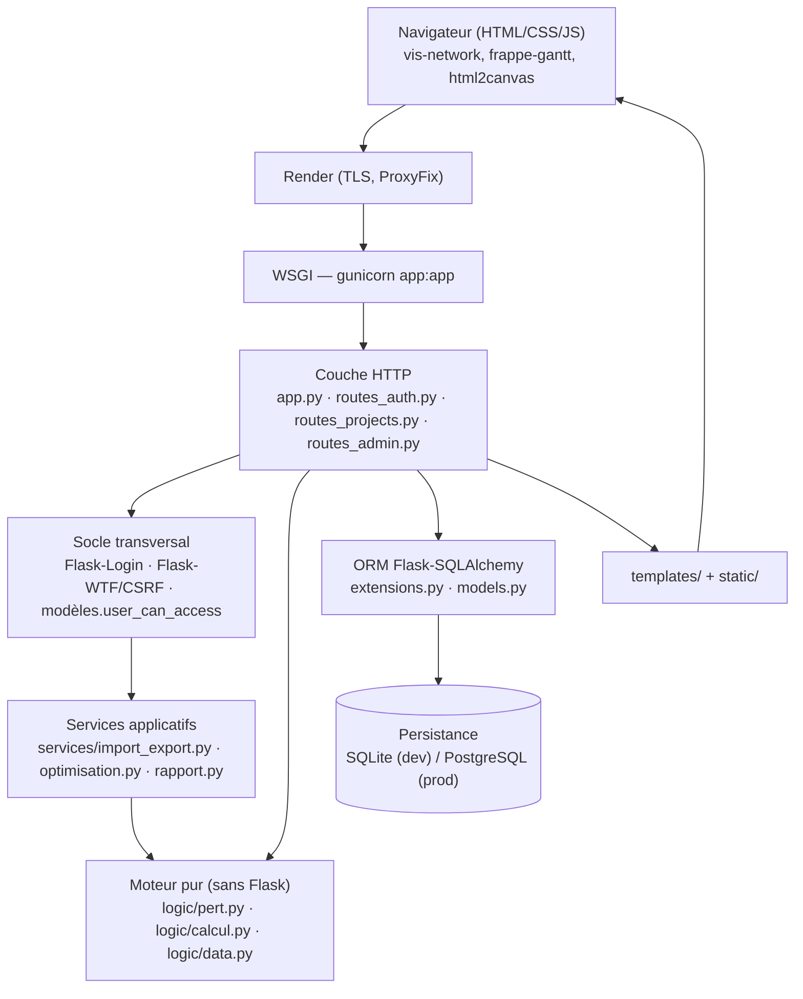
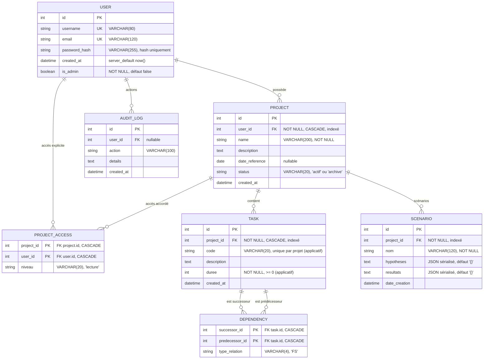

# Documentation technique — PERT/CPM PRO

**Date :** 21 novembre 2026  
**Version du document :** 1.0  
**Références :** `docs/Cahier_des_charges_PERT_CPM_PRO.docx` (v1.0), `docs/convention_calcul.md`, `docs/audit.md`, `docs/plan_implementation.md`.  
**État du livrable :** lots 0 à 6 livrés (moteur certifié, socle sécurisé, persistance, espace projets/tâches, visualisations, optimisation, exports serveur). Le blueprint d'administration (`routes_admin.py`) est en cours de finalisation par un autre agent ; les fonctions IA du chapitre 19 du cahier ne sont pas implémentées.  
**Application déployée :** <https://app-pert-cpm.onrender.com/> — supervision : `GET /health`.

> Ce document décrit le code tel qu'il existe dans le dépôt. Toute divergence constatée avec l'application déployée doit être consignée dans `docs/audit.md` avant d'être corrigée.

## 1. Architecture

### 1.1 Schéma des couches



Lecture du schéma :

1. **Entrée** : requête HTTPS terminée par Render, transmise à gunicorn ; `ProxyFix` rétablit le schéma, l'hôte et l'adresse IP d'origine (`app.py`).
2. **Routage et sécurité** : les blueprints appliquent `login_required`, le contrôle d'accès serveur et les jetons CSRF ; `ajouter_en_tetes_securite()` complète la réponse.
3. **Métier** : les routes ne stockent que des données sources (tâches, durées, prédécesseurs) ; elles appellent toujours le moteur pour obtenir les résultats chiffrés.
4. **Sortie** : rendu Jinja2 ou téléchargement (`send_file`) pour CSV, XLSX et PDF.

### 1.2 Principes directeurs

- Le **moteur `logic/pert.py` est la seule source de vérité mathématique** : aucun chiffre n'est accepté depuis le navigateur, y compris pour les exports (`/export_excel` recalcule tout côté serveur).
- Les routes et les modèles sont séparés du calcul : le moteur est un module Python pur, importable et testable sans Flask.
- Les droits sont **toujours vérifiés côté serveur** (`user_can_access()`, `admin_required()`), jamais seulement masqués dans l'interface.
- Les simulations d'optimisation ne modifient jamais le planning de référence sans confirmation explicite.

## 2. Modules et responsabilités

| Fichier / dossier | Responsabilité |
|---|---|
| `app.py` | Fabrique l'application Flask, charge la configuration, initialise les extensions, enregistre les blueprints, définit `ProxyFix`, les en-têtes de sécurité, la journalisation stdout, les routes historiques et les gestionnaires d'erreurs (413, 404, 500, exceptions non prévues). |
| `config.py` | `Config` (développement), `ProductionConfig` (secrets obligatoires, cookies sûrs), `TestConfig` (SQLite mémoire, CSRF désactivé). Normalise `postgres://` en `postgresql://`. |
| `extensions.py` | Instances partagées `db` (SQLAlchemy), `login_manager` (Flask-Login), `csrf` (Flask-WTF). |
| `models.py` | Entités `User`, `Project`, `Task`, `Dependency`, `ProjectAccess`, `Scenario`, `AuditLog` ; hachage des mots de passe ; `project_to_taches()` ; `user_can_access()` ; `init_db()` (`db.create_all()`). |
| `routes_auth.py` | Blueprint `auth` : inscription, connexion, déconnexion, profil ; validation serveur, messages génériques, filtrage de `next` contre les redirections ouvertes. |
| `routes_projects.py` | Blueprint `projects` (préfixe `/projects`) : CRUD projets/tâches, archivage, import/export, rapport PDF, scénarios d'optimisation, journalisation des actions. |
| `routes_admin.py` *(en cours)* | Blueprint `admin` (préfixe `/admin`) : tableau de bord, gestion du rôle administrateur, consultation du journal. Enregistrement conditionnel dans `app.py` (`try: from routes_admin import admin_bp`). |
| `logic/pert.py` | Moteur canonique : validation, tri topologique de Kahn, passes avant/arrière, marges, criticité à `EPSILON = 1e-9`, énumération de **tous** les chemins critiques. Lève `ValidationError`. |
| `logic/calcul.py` | Façade de compatibilité (`passe_avant`, `passe_arriere`, `calculer_marges`, `generer_conseils`, réexport du moteur). |
| `logic/data.py` | Jeu de démonstration (12 tâches, `D = 30` jours) et `parser_taches()` (saisie `nom;description;duree;pred1,pred2`). |
| `services/import_export.py` | Import CSV/XLSX avec aperçu et erreurs numérotées ; exports CSV (UTF-8 BOM, `;`) et XLSX (onglet « Résultats »), neutralisation des formules. |
| `services/optimisation.py` | `simuler()` : deux calculs déterministes (initial et copie modifiée), gains, hypothèses, limites ; aucune écriture en base. |
| `services/rapport.py` | `generer_rapport_pdf()` : rapport A4 paysage en deux pages, tableau détaillé, réseau PERT et Gantt générés avec matplotlib (`Agg`), texte extractible et échappé. |
| `templates/`, `static/` | Gabarits Jinja2 (historiques, `auth/`, `projects/`, `admin/`) et feuilles de style. |
| `tests/` | 86 tests `unittest` : moteur, parseur, HTTP, auth/projets, modèles, import/export, optimisation, rapport PDF. |
| `scripts/backup.py`, `scripts/restore.py` | Sauvegarde et restauration SQLite (voir `docs/sauvegarde.md`). |
| `requirements.txt`, `docs/` | Dépendances figées et documentation fonctionnelle/opérationnelle. |

## 3. Modèle de données

### 3.1 Diagramme relationnel



### 3.2 Contraintes et règles d'intégrité

| Table | Clé primaire | Contraintes notables |
|---|---|---|
| `user` | `id` | `username` et `email` uniques ; comparaison insensible à la casse côté application (`func.lower`) ; `password_hash` toujours haché (`generate_password_hash`) ; `is_admin` non nul. |
| `project` | `id` | `user_id` obligatoire, FK `user.id` `ON DELETE CASCADE`, indexée ; `status` : `actif` / `archive`. |
| `task` | `id` | `project_id` obligatoire, FK `project.id` `ON DELETE CASCADE`, indexée ; `code` unique **au sein d'un projet** (contrôle applicatif dans `_donnees_tache()`, pas de contrainte DB) ; `duree` entière ≥ 0 (contrôle applicatif et moteur, pas de `CHECK` DB). |
| `dependency` | `(successor_id, predecessor_id)` | deux FK vers `task.id` en `ON DELETE CASCADE` ; `UNIQUE (successor_id, predecessor_id)` nommée `uq_dependency_pair` ; `type_relation = 'FS'` (les autres types ne sont pas calculés) ; l'absence de cycle est vérifiée par le moteur, pas par la base. |
| `project_access` | `(project_id, user_id)` | FK en `ON DELETE CASCADE` vers `project` et `user` ; `niveau` (`lecture` par défaut) n'est pas encore différencié dans les contrôles d'accès. |
| `scenario` | `id` | `project_id` obligatoire et indexé (FK sans cascade explicite) ; `hypotheses` et `resultats` sont du JSON stocké en `TEXT` ; scénario non appliqué au planning de référence. |
| `audit_log` | `id` | `user_id` nullable (trace d'actions même après suppression d'un compte, FK sans cascade) ; `action`, `details`, `created_at`. |

Relations fonctionnelles :

- `models.project_to_taches(project)` convertit les `Task` + `Dependency` en `{code: {description, duree, depend_de}}` pour le moteur.
- `models.user_can_access(project, user)` autorise le **propriétaire**, un **administrateur** ou un utilisateur disposant d'une ligne `ProjectAccess`.
- `models.init_db(app)` exécute `db.create_all()` au démarrage. Cette fonction **crée les tables absentes** mais ne modifie pas les tables existantes : voir §9 pour les évolutions de schéma.

## 4. Configuration

| Variable | Valeur par défaut | Rôle |
|---|---|---|
| `SECRET_KEY` | `dev-secret-key-a-changer` avec `Config` | Signature des sessions et des jetons CSRF. `ProductionConfig` **exige** la variable et refuse de démarrer si elle manque. |
| `DATABASE_URL` | `sqlite:///pert_cpm.db` | URI SQLAlchemy. Le préfixe `postgres://` fourni par Render est normalisé en `postgresql://`. `TestConfig` force `sqlite:///:memory:`. |
| `APP_SETTINGS` | `config.Config` | Classe de configuration Python : `config.Config`, `config.ProductionConfig` (recommandé en prod) ou `config.TestConfig`. |
| `FLASK_DEBUG` | non défini | `1` active le debug et le niveau de journal `DEBUG` en **développement uniquement** ; jamais en production. |
| `PORT` | — | Fourni par Render ; utilisé par la commande de démarrage gunicorn (`--bind 0.0.0.0:$PORT`). |

Paramètres figés dans le code : `MAX_CONTENT_LENGTH = 8 Mo`, `SQLALCHEMY_TRACK_MODIFICATIONS = False`, `WTF_CSRF_ENABLED = True` (False sous `TestConfig`), `ProxyFix(x_for=1, x_proto=1, x_host=1)`, journalisation sur stdout.

`ProductionConfig` applique en outre `SESSION_COOKIE_SECURE = True`, `SESSION_COOKIE_HTTPONLY = True`, `SESSION_COOKIE_SAMESITE = 'Lax'`, `PREFERRED_URL_SCHEME = 'https'`, `DEBUG = False`, `TESTING = False`.

## 5. Routes HTTP

La liste contractuelle est obtenable à tout moment avec :

```bash
python -c "from app import app; [print(','.join(sorted(r.methods - {'HEAD','OPTIONS'})), r.rule) for r in app.url_map.iter_rules()]"
```

### 5.1 Routes publiques et historiques

| Méthode | Chemin | Description |
|---|---|---|
| GET | `/` | Page d'accueil. |
| GET | `/health` | Supervision : `{"status": "ok"}` (aucune authentification, utilisé par Render). |
| GET | `/demo` | Démonstration 12 tâches : 30 jours, chemin `A → B → G → H → K → L`. |
| GET | `/saisie` | Formulaire de saisie texte historique. |
| POST | `/resultats_custom` | Parse et calcule la saisie ; rend tableau, graphe et Gantt. **Exempté CSRF** (formulaire historique sans jeton). |
| POST | `/export_excel` | Export XLSX 3 onglets ; recalcul serveur obligatoire et images PNG validées. **Exempté CSRF**. |

### 5.2 Authentification (blueprint `auth`)

| Méthode | Chemin | Accès | Description |
|---|---|---|---|
| GET, POST | `/register` | public | Création de compte ; mot de passe ≥ 8 caractères, confirmé et haché. |
| GET, POST | `/login` | public | Connexion par nom d'utilisateur ou e-mail ; `next` limité à un chemin local. |
| GET | `/logout` | connecté | Déconnexion et redirection vers l'accueil. |
| GET, POST | `/profile` | connecté | Modification du nom, de l'e-mail et du mot de passe (ancien mot de passe requis). |

### 5.3 Projets et tâches (blueprint `projects`)

Toutes ces routes exigent une session authentifiée. Le helper `_projet_ou_404()` renvoie **404** si le projet n'existe pas et **403** si l'utilisateur n'y a pas accès.

| Méthode | Chemin | Description |
|---|---|---|
| GET | `/projects/` | Liste des projets accessibles (nom, nombre de tâches, durée calculée). |
| GET, POST | `/projects/new` | Création d'un projet. |
| GET | `/projects/<int:project_id>` | Détail : indicateurs, tableau PERT, chemins critiques, erreur de calcul éventuelle. |
| GET, POST | `/projects/<id>/edit` | Modification du projet. |
| POST | `/projects/<id>/delete` | Suppression après saisie de `confirm=oui`. |
| POST | `/projects/<id>/archive` / `/unarchive` | Archivage / désarchivage. |
| GET, POST | `/projects/<id>/optimisation` | Simulation de réductions et enregistrement optionnel d'un `Scenario`. |
| GET, POST | `/projects/<id>/import` | Import CSV/XLSX avec aperçu, détection des collisions et rapport d'erreurs. |
| GET | `/projects/<id>/export.csv` | Export CSV des résultats calculés côté serveur. |
| GET | `/projects/<id>/export.xlsx` | Export XLSX des résultats calculés côté serveur. |
| GET | `/projects/<id>/rapport.pdf` | Génération du rapport PDF serveur. |
| GET, POST | `/projects/<id>/tasks/new` | Création d'une tâche et de ses dépendances. |
| GET, POST | `/projects/<id>/tasks/<int:task_id>/edit` | Modification d'une tâche et recalcul de validation. |
| POST | `/projects/<id>/tasks/<int:task_id>/delete` | Suppression après confirmation. |

### 5.4 Administration (blueprint `admin` — finalisation en cours)

Le blueprint définit le préfixe `/admin` et le décorateur `admin_required` (`login_required` puis vérification de `current_user.is_admin`, sinon 403). Son enregistrement dans `app.py` est conditionnel à la disponibilité du module ; vérifier la présence effective des routes avec la commande du §5.

| Méthode | Chemin | Accès | Description |
|---|---|---|---|
| GET | `/admin/` | admin | Compteurs (utilisateurs, projets actifs/archivés, tâches, scénarios, audits) et 10 dernières actions. |
| GET | `/admin/utilisateurs` | admin | Liste des comptes et nombre de projets par utilisateur. |
| POST | `/admin/utilisateurs/<int:user_id>/admin` | admin | Octroi / retrait du rôle admin ; l'auto-rétrogradation est refusée et journalisée. |
| GET | `/admin/journal?action=...` | admin | 100 dernières entrées d'audit, filtre optionnel par action. |

### 5.5 Gestion des erreurs

| Code | Comportement |
|---|---|
| 400 | Corps invalide sur `/export_excel` (JSON d'erreur) et requête > 8 Mo (handler 413 renvoyant 400). |
| 403 | Accès à un projet d'autrui ou à une page admin sans le rôle requis. |
| 404 | Ressource inexistante ou URL inconnue (page `erreur.html`). |
| 500 | Page générique ; la trace détaillée est journalisée côté serveur uniquement (sauf `TESTING`, où l'exception est relancée). |

## 6. Démarrage local et lancement des tests

### 6.1 Installation

```bash
git clone https://github.com/savadogotresor-pixel/APP_PERT_CPM.git
cd APP_PERT_CPM
python -m venv .venv
# Windows (PowerShell) : .venv\Scripts\Activate.ps1
# Linux/macOS : source .venv/bin/activate
pip install -r requirements.txt
```

### 6.2 Lancement

```powershell
# Windows / PowerShell
$env:APP_SETTINGS = "config.Config"
$env:FLASK_DEBUG = "1"          # développement uniquement
python app.py
```

```bash
# Linux / macOS
APP_SETTINGS=config.Config FLASK_DEBUG=1 python app.py
```

Ouvrir <http://127.0.0.1:5000>. Par défaut, la base est `instance/pert_cpm.db` (Flask-SQLAlchemy place les URI SQLite relatives dans le dossier `instance/`). Pour utiliser la configuration de production en local, définir **obligatoirement** `SECRET_KEY` et `DATABASE_URL` puis `APP_SETTINGS=config.ProductionConfig`.

Serveur WSGI (production) : `gunicorn app:app --bind 0.0.0.0:$PORT --workers 2 --timeout 120`.

### 6.3 Tests

```bash
python -m unittest discover -s tests -v
```

Sous Windows avec l'interpréteur Anaconda :

```powershell
& 'C:\Users\ASUS\anaconda3\python.exe' -m unittest discover -s tests -v
```

La suite compte **86 tests** répartis dans `test_pert.py`, `test_parser.py`, `test_app.py`, `test_models.py`, `test_auth_projects.py`, `test_import_export.py`, `test_optimisation.py` et `test_rapport.py`. `TestConfig` utilise une base SQLite en mémoire et désactive CSRF ; les tests HTTP d'authentification positionnent `APP_SETTINGS` avant d'importer `app`. Un test ciblé s'exécute avec `python -m unittest tests.test_pert -v`. Le détail des cas figure dans `docs/recette.md`.

## 7. Flux de calcul PERT

```text
Données sources (BDD ou saisie)
  → project_to_taches() / parser_taches()    {code: {description, duree, depend_de}}
  → logic.pert.validate()                    erreurs accumulées (durées, codes, prédécesseurs, cycle)
  → _kahn()                                  ordre topologique itératif O(V + E)
  → passe avant                              ES = 0 ou max(EF prédécesseurs) ; EF = ES + d
  → durée totale D                           max(EF des tâches terminales)
  → passe arrière                            LF = D ou min(LS successeurs) ; LS = LF - d
  → marges                                   MT = LS - ES ; ML = min(ES successeurs) - EF
  → criticité                                |MT| <= EPSILON (1e-9)
  → chemins critiques                        sous-graphe critique, de chaque source à chaque puits
  → PERTResult(duree_totale, resultats, chemins_critiques, successeurs, ordre)
```

Points clés :

- `durée = 0` est valide (jalon) et n'est pas une erreur ; les durées négatives, booléennes, non finies ou non numériques sont refusées.
- Un prédécesseur inexistant ou un cycle (y compris une auto-dépendance) lève `ValidationError` avec un message explicite en français, sans boucle infinie.
- Les résidus flottants inférieurs à `1e-9` sont ramenés à zéro : les chemins multiples sont détectés de façon déterministe.
- Tous les consommateurs (détail de projet, exports, optimisation, rapport PDF) appellent `compute()` sur les données sources ; aucun résultat n'est persisté en base.
- La démo de référence doit toujours donner `D = 30` et `A → B → G → H → K → L` (tests `test_demo_12_taches` et `test_demo_reference`).

La convention temporelle complète (fin exclusive, jours calendaires, marges) est décrite dans `docs/convention_calcul.md`.

## 8. Sécurité

| Mesure | Mise en œuvre |
|---|---|
| CSRF | `CSRFProtect` initialisé dans `app.py` ; jetons dans les formulaires Flask-WTF des pages auth/projets/admin. Deux routes historiques (`/resultats_custom`, `/export_excel`) restent **exemptées** : À migrer vers des formulaires tokenisés. |
| Hachage | `User.set_password()` utilise `werkzeug.security.generate_password_hash()` ; vérification par `check_password_hash()`. Aucun mot de passe en clair, ni en base, ni dans les journaux. Longueur minimale : 8 caractères. |
| Contrôle d'accès | `@login_required` sur les routes privées ; `_projet_ou_404()` (403) et `_tache_ou_404()` ; `user_can_access()` (propriétaire, admin, `ProjectAccess`) ; `admin_required()` pour `/admin/*` ; message d'erreur de connexion volontairement générique ; `next` restreint aux chemins locaux. |
| En-têtes HTTP | `after_request` ajoute `X-Content-Type-Options: nosniff`, `X-Frame-Options: DENY`, `Referrer-Policy: strict-origin-when-cross-origin`, une CSP (CDN nécessaires aux graphiques) et `Strict-Transport-Security` sur les requêtes sécurisées. `ProxyFix` permet à Flask de reconnaître le TLS terminé par Render. |
| Sessions | `ProductionConfig` : cookies `Secure`, `HttpOnly`, `SameSite=Lax`, `PREFERRED_URL_SCHEME=https`. Le secret de session est obligatoire en production. |
| Entrées | `MAX_CONTENT_LENGTH = 8 Mo` ; validation serveur de toutes les données (formulaires, parseur, import) ; requêtes paramétrées via l'ORM ; aperçu et rapport d'erreurs avant import ; neutralisation des formules CSV/XLSX. |
| Exports et rapports | Chiffres systématiquement recalculés par le moteur ; data URL PNG validées et décodées côté serveur ; valeurs échappées avant injection dans le PDF ; traces techniques jamais renvoyées à l'utilisateur. |
| Journalisation | `AuditLog` trace créations/modifications/suppressions de projets et tâches, imports, exports, scénarios et changements de rôle. Logs applicatifs sur stdout, exploités depuis le tableau de bord Render. |

Points de vigilance : la limitation des tentatives de connexion prévue au §11 du cahier n'est pas encore implémentée ; le rôle `niveau` de `ProjectAccess` n'est pas encore différencié ; les pages historiques publiques restent accessibles sans session.

## 9. Procédure de mise à jour

1. **Préparer** : prévenir les utilisateurs, vérifier l'état de `GET /health`, consulter les derniers journaux Render.
2. **Sauvegarder** : exécuter la procédure de `docs/sauvegarde.md` (base SQLite ou `pg_dump` PostgreSQL) et consigner le fichier dans le registre.
3. **Récupérer le code** : `git fetch && git checkout <sha>` (ou merge de la branche validée) ; lire les notes de version.
4. **Installer** : `pip install -r requirements.txt` (ou laisser Render reconstruire le service).
5. **Tester** : `python -m unittest discover -s tests -v` ; les 86 tests doivent passer. Compléter par la recette de `docs/recette.md` si le changement touche aux calculs, aux droits ou aux exports.
6. **Schéma** : au démarrage, `init_db(app)` appelle `db.create_all()` ; les tables manquantes sont créées. Pour modifier une colonne existante, écrire un script SQL versionné et l'appliquer **avant** le redéploiement (aucun outil de migrations tel qu'Alembic n'est installé à ce jour).
7. **Déployer** : pousser le commit sur la branche configurée dans Render ou relancer le déploiement manuel ; surveiller les journaux de build et de démarrage.
8. **Vérifier** : `GET /health`, connexion, ouverture d'un projet, calcul, export PDF, puis contrôle des erreurs dans `/admin/journal`. En cas d'échec, appliquer la procédure de rollback de `docs/deploiement.md`.
9. **Clore** : mettre à jour le registre des sauvegardes et la fiche de recette ; archiver la preuve de restauration si le schéma a changé.
